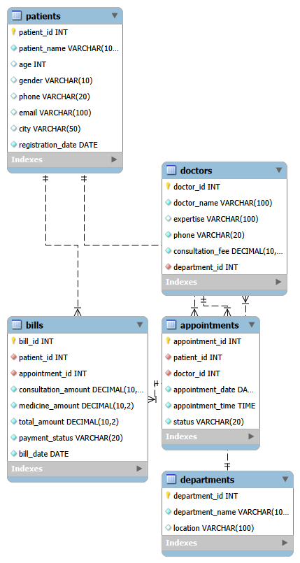

# Hospital Management System

## About the Project

The Hospital Management System is a database project developed using MySQL. It helps manage hospital information, including patients, doctors, departments, appointments and billing records.

## Technologies Used

- MySQL
- MySQL Workbench
- SQL

## Database Name

HospitalManagement_ERD

## Database Tables

1. Patients
2. Departments
3. Doctors
4. Appointments
5. Bills

## Features

- Create and manage hospital databases.
- Store patient information.
- Manage doctors and departments.
- Schedule and track appointments.
- Maintain patient billing information.
- Use primary keys and foreign keys.
- Apply UNIQUE, NOT NULL and DEFAULT constraints.
- Perform INSERT, UPDATE and DELETE operations.
- Retrieve information using SELECT queries.
- Perform filtering and sorting.
- Use aggregate functions.
- Retrieve related information using JOINs.
- Use subqueries and built-in SQL functions.

## ER Diagram

The Entity Relationship Diagram represents the relationships between the five database tables.



## How to Run

1. Install MySQL Server and MySQL Workbench.
2. Open MySQL Workbench.
3. Open `hospital_management.sql`.
4. Execute the SQL script.
5. View the created tables and records.
6. Use Database → Reverse Engineer to generate the ER diagram if required.

## Project Structure

```text
Hospital-Management-System/
│
├── hospital_management.sql
├── ER_Diagram.png
├── Hospital_Management.mwb
├── README.md
└── .gitignore
```

## Author

Created as a MySQL database management project.
=======
# Hospital-Management-System
A MySQL-based Hospital Management System with database design, ER diagram, SQL queries and relational tables.
>>>>>>> a147ead435bb93f847b2e1423afce4736a40e620
